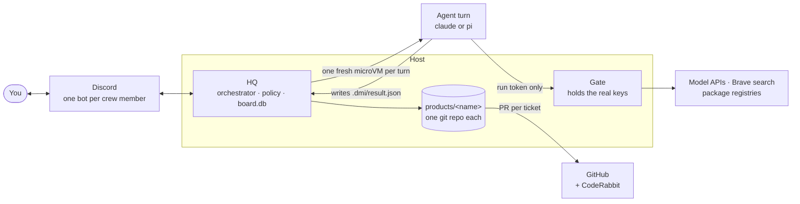
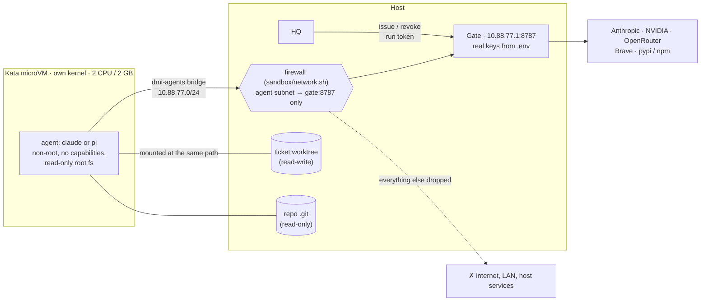

# Dunder Mifflin

A company of AI agents. You're the PM. Agents talk to each other in turn-based
conversations; after 3 rounds without agreement, HQ tags you.

Crew (from The Office): Ryan (Scout), Oscar (Analyst), Pam (Designer), Jim (Architect),
Darryl (Engineer), Dwight (QA), Michael (Manager, also the system bot).

```
DISCOVERY   Scout ⇄ Analyst                        ≤3 rounds → brief → you approve
UX          Designer ⇄ you                         as long as you like → you approve
SYSTEM      Architect ⇄ Designer, then ⇄ you       → you approve
BUILD       per ticket: plan (Architect) → Engineer ⇄ QA → Designer review (UI tickets)
            all reviews pass → pull request → CodeRabbit review triaged → you merge
STUCK       round limit or a repeated failure → Michael steps in once: fix / ruling / replan / escalate
            still stuck → @you: [Try again] [Ask Michael] [Give guidance] [Drop]
```

Every agent run with tools happens in its own Kata microVM; real API keys stay on the host.

## Architecture



HQ is the only long-running process, and it holds no LLM. It keeps the board, decides whose turn it is, launches
one short-lived agent job per turn and applies the result. Agents are stateless: everything they know comes from
the prompt HQ builds for that turn.

### One turn

1. Every `tick_seconds` (30) HQ looks for items whose turn is due and runs up to `max_concurrent` (4) at once.
2. `hq/prompts.py` builds what the agent sees: its charter as the system prompt, plus the company docs, the product
   or ticket, the conversation so far and the role's notes.
3. HQ boots a fresh Kata microVM. Only the working directory is writable (a scratch dir for discovery and design, the
   ticket's git worktree for build); the root filesystem is read-only and the rest of the host is invisible.
4. The agent runs its harness (`claude` or `pi`) with the model `config/dmi.yaml` gives its role. Its only network
   route is the gate, which swaps the run's short-lived token for the real API key and allows only what the role
   was granted (web search, package installs).
5. The agent leaves `.dmi/result.json`: its message and the move it proposes. The VM is destroyed and the token
   revoked.
6. HQ checks the move against `hq/policy.py`, applies it and writes the message to the board, which doubles as the
   Discord outbox: the crew member's bot posts it.
7. The next speaker gets the floor. After `max_rounds` (3) without agreement Michael steps in once; if it's still
   stuck, HQ tags you with buttons.

### The sandbox: one Kata microVM per turn

Agents run code they wrote, packages they installed and pages they fetched, so HQ treats every agent as untrusted.
A normal container shares the host's kernel, and one kernel bug is enough to escape it. [Kata
Containers](https://katacontainers.io) run each container inside a lightweight VM with its own kernel, so an
agent that breaks out of its container is still inside a VM that can reach nothing. HQ starts them through
containerd (`nerdctl run --runtime io.containerd.kata.v2`), one VM per turn, deleted when the turn ends.



**What a VM gets**

| | |
|---|---|
| Image | `dmi-agent` ([sandbox/agent.Dockerfile](sandbox/agent.Dockerfile)): Debian with Node 24, git, Python, a Swift toolchain, the `claude` and `pi` CLIs at pinned versions, and the web tools. Runs as the non-root user `agent`. |
| Files | The root filesystem is read-only. The working directory (a ticket's worktree, or a scratch dir) is the only writable mount, at the same path as on the host so prompts stay valid. The product repo's `.git` and any reference dirs are read-only, so the agent can read history but can't rewrite it: HQ makes the commits, on the host. `/tmp` and the home dir are 1 GB scratch space that disappears with the VM. |
| Privileges | All Linux capabilities dropped, `no-new-privileges`. |
| Resources | 2 CPUs and 2 GB by default (a role can ask for more with `vm:`). HQ waits for that much free memory plus 768 MB of headroom before booting, so a busy machine queues VMs instead of crashing. Each role has a time limit; a run that exceeds it is killed and the VM destroyed. |
| Network | Only the gate. No DNS (lookups fail instantly); every endpoint is reached by the gate's IP. |
| Secrets | One environment variable, `DMI_RUN_TOKEN`. No API key, GitHub token or Discord token ever enters a VM. |

**The network lockdown.** VMs sit on their own bridge, `dmi-agents` (10.88.77.0/24). [sandbox/network.sh](sandbox/network.sh)
adds rules to the `mangle` table's `PREROUTING` chain, which runs before any Docker or CNI rule can let a packet
through: TCP from the agent subnet to the gate's port is allowed, every other packet from that subnet is dropped,
and the gate's port is closed to everyone except the agents and localhost. Agents get no IPv6 address, and the gate's
port is closed over IPv6 as well. The
rules are installed as a root-owned boot service (`dmi-sandbox-network`, by [sandbox/install-boot.sh](sandbox/install-boot.sh)),
and HQ re-checks them before booting **every** VM: if they're missing, it refuses to run agents (fails closed).

**The gate** ([hq/gate.py](hq/gate.py)) is a small proxy on the host and the only thing a VM can talk to:

| Route | What it does | Who may use it |
|---|---|---|
| `/llm/<provider>/...` | Forwards model calls to Anthropic, NVIDIA or OpenRouter, swapping the run token for the real key | only the provider of that role's model |
| `/tools/search?q=` | Brave web search | roles with `web: true` (the Scout) |
| `/tools/fetch?url=` | A public web page as text; private and local addresses are refused | roles with `web: true` |
| `CONNECT host:443` | HTTPS proxy to `pypi.org`, `files.pythonhosted.org` and `registry.npmjs.org` only | roles with `packages: true` |

A run token is issued just before its VM boots and revoked as soon as it exits. It works only for what that run
was granted, expires shortly after the role's time limit, and is capped at 600 requests. A hijacked agent can't
leak a real key, reach another machine, or run up an unlimited bill.

**Lifecycle of one VM:** check the firewall → wait for memory → issue a run token → boot the VM with the mounts
above → the agent works and writes `.dmi/result.json` → the VM exits (or is killed at the time limit) → revoke the
token and delete the run's scratch files. When HQ starts, it removes any VM or scratch dir a previous run left
behind.

**What runs outside the VMs:** HQ itself, the gate, the Discord bots, every git commit, push and PR, and casual chat
replies (a small model with no tools and no file access). `safety.sandbox: host` in the config runs agents
directly on the machine instead. That is only for development: it has none of the protections above.

### From idea to launch

| Stage | Who | What it produces | Moves on when |
|---|---|---|---|
| Discovery | Ryan ⇄ Oscar | a product brief | you approve |
| UX | Pam ⇄ you | the product's git repo; `design/ux.md` and screens `S01`, `S02`... as HTML mockups | you approve |
| System | Jim ⇄ Pam, then Jim ⇄ you | `design/system.md` and the tickets | you approve |
| Build (per ticket) | Jim plans → Darryl ⇄ Dwight → Pam (UI tickets) | one squashed commit, a PR into `develop`, CodeRabbit's comments triaged by Jim | you merge |
| Launch | you | `master` fast-forwarded to `develop` and tagged `v<n>` | — |

Each ticket is built on its own branch in its own worktree (`.dmi-work/<product>/T-<n>/`), so tickets run in
parallel without touching each other. Darryl can ask Jim or Pam questions mid-build.

### Where state lives

- `.dmi/board.db`: products, tickets, conversations and agent runs (SQLite). Only HQ writes to it.
- `products/<name>/`: one git repo per product. `develop` gets one commit per ticket; `master` moves only at launch.
  The design library (`design/`) is committed from the first draft, so every screen has history.
- `config/dmi.yaml`: models per role, round limits, budgets, Discord channels.
- `.env`: every key and token. Only HQ and the gate read it.

### Trust boundaries

- Agents never change state themselves. They propose a move; HQ checks it against the policy and applies it.
- Agents hold no secrets: no API keys, no GitHub token, no Discord token. A run token works only through the gate,
  only for what that run was granted, and expires with the VM.
- An agent VM can reach nothing but the gate. Pushing, opening PRs and posting to Discord are done by HQ.

## Layout

```
hq/             board, policy, orchestrator, harness, Discord bot, CLI
agents/<role>/  charter.md per role; _conversation.md is shared
company/        handbook, spec, decisions; every agent reads these
config/dmi.yaml models per role, round limits, gates, budgets, Discord channels
deploy/ sandbox/  systemd service, microVM image and firewall
```

## Setup

```bash
uv sync
uv run dmi init
```

Put all keys in `~/dmi/.env` (created for you, owner-only, ignored by git), then run `uv run dmi doctor`.

- Claude roles use the `claude` CLI and its login.
- Open models use `pi` on free tiers: `NVIDIA_API_KEY` (build.nvidia.com) and `OPENROUTER_API_KEY` (`:free` models).
- Scout search: `BRAVE_API_KEY` (free tier).
- GitHub: `GITHUB_TOKEN`, a fine-grained token with **Contents**, **Pull requests** and **Issues** read/write.
  Only HQ uses it; agents never touch GitHub.

## Discord

One bot per crew member. Michael's bot also runs the server layout, approval buttons, alerts and slash commands.

1. Create a server called "Dunder Mifflin". Add `DISCORD_GUILD_ID` and `DISCORD_PM_USER_ID` (your user ID) to `.env`.
2. For each of Michael, Ryan, Oscar, Pam, Jim, Darryl and Dwight: create an application at
   discord.com/developers/applications, reset the bot token, and put it in `.env` as `DISCORD_TOKEN_<NAME>`.
   Michael's bot needs **Message Content Intent**.
3. `uv run dmi doctor` prints each bot's invite link; then run `uv run dmi discord`.

Talk to the crew with `@Name ...` or by DM. Reply in a thread to steer work; buttons handle approvals.
Slash commands: `/discover`, `/new`, `/digest`, `/screens`, `/crew`.

## Pull requests and CodeRabbit

Each ticket that passes QA becomes a pull request into `develop`. You get a **Ship it** gate, or merge it on
GitHub and HQ notices.

While a PR waits for you, HQ watches for CodeRabbit's review. Jim triages the comments against the code, the plan
and the design: real bugs and missed acceptance criteria go to Darryl (then Dwight re-checks and HQ pushes to the
same branch); style, speculation and anything that contradicts the design are skipped, and Jim's reason is posted
as a reply in that comment's thread. Each ticket gets at most `github.coderabbit.max_rounds` (2) fix rounds;
after that the comments are left for you.

## Running it

Dunder Mifflin runs as a system service: it starts at boot and restarts itself if it crashes.

```bash
sudo deploy/install-service.sh      # once, after `uv sync`
sudo systemctl restart dmi          # graceful: running agents finish, then restart
journalctl -u dmi -f                # live logs
uv run dmi doctor                   # keys, bots, sandbox, service
uv run dmi board                    # everything, with "needs you" marked
```

Try every pipeline without calling a model: `DMI_HARNESS=fake uv run dmi tick`. Tests: `uv run pytest`.

## Not built yet

A marketing role.
