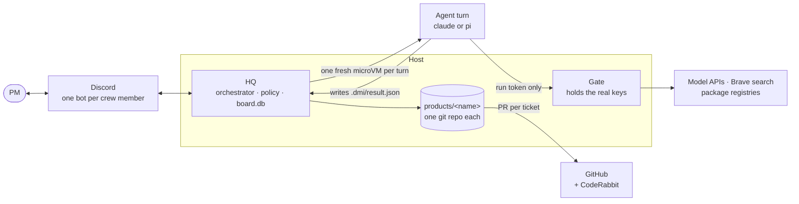
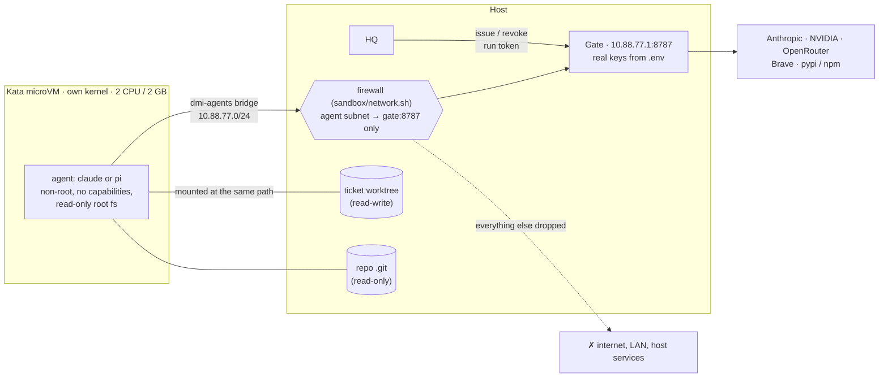

# Dunder Mifflin

A company of AI agents, run by one person: the PM (the operator, who owns this system). Agents talk to each other in
turn-based conversations; after 3 rounds without agreement, HQ tags the PM.

Crew (from The Office): Ryan (Scout), Oscar (Analyst), Pam (Designer), Jim (Architect),
Darryl (Engineer), Dwight (QA), Michael (Manager, also the system bot).

| Who | Role | What they do |
|---|---|---|
| Ryan | Scout | Researches an idea the PM brings when tagged in `#ideas` (competitors, demand, risks, name clashes, with sources). Starts research on his own only if `discovery` is enabled or `/discover` is used. |
| Oscar | Analyst | Validates the PM's ideas, asks what's unclear, discusses the product's name with the PM and writes the brief. |
| Pam | Designer | Designs the UX: screens `S01`, `S02`..., the design system and the logo. Reviews UI tickets against the screens. |
| Jim | Architect | Asks the PM which tech stack to use, writes the system design and the ticket list, plans each ticket and triages review comments. |
| Darryl | Engineer | Builds a ticket from Jim's plan and fixes review and build feedback. |
| Dwight | QA | Tests what Darryl built before a PR is opened. |
| Michael | Manager | Steps in once when a conversation is stuck; his bot also runs the Discord layout, buttons and the inbox. |

```
DISCOVERY   Analyst ⇄ PM (Scout researches first if tagged) → brief → PM approves
UX          Designer ⇄ PM (screens and logo)       as long as needed → PM approves
SYSTEM      Architect ⇄ Designer, then ⇄ PM        → PM approves the design
TICKETS     Architect posts the drafted tickets    → PM comments (Architect revises) or approves; then they exist
BUILD       per ticket: plan (Architect) → Engineer ⇄ QA → Designer review (UI tickets)
            all reviews pass → pull request → CodeRabbit review triaged → PM merges
STUCK       round limit or a repeated failure → Michael steps in once: fix / ruling / replan / escalate
            still stuck → @PM: [Try again] [Ask Michael] [Give guidance] [Drop]
```

Every agent run with tools happens in its own Kata microVM; real API keys stay on the host.

## Architecture



HQ is the only long-running process, and it holds no LLM. It keeps the board, decides whose turn it is, launches
one short-lived agent job per turn and applies the result. Agents are stateless: everything they know comes from
the prompt HQ builds for that turn.

### One turn

1. Every `tick_seconds` (30) HQ looks for items whose turn is due and runs up to `max_concurrent` (4) at once.
2. `hq/prompts.py` builds what the agent sees: its charter as the system prompt, plus the company docs, the product
   or ticket, the conversation so far and the role's notes.
3. HQ boots a fresh Kata microVM. Only the working directory is writable (a scratch dir for discovery and design, the
   ticket's git worktree for build); the root filesystem is read-only and the rest of the host is invisible.
4. The agent runs its harness (`claude` or `pi`) with the model `config/dmi.yaml` gives its role. Its only network
   route is the gate, which swaps the run's short-lived token for the real API key and allows only what the role
   was granted (web search, package installs).
5. The agent leaves `.dmi/result.json`: its message and the move it proposes. The VM is destroyed and the token
   revoked.
6. HQ checks the move against `hq/policy.py`, applies it and writes the message to the board, which doubles as the
   Discord outbox: the crew member's bot posts it.
7. The next speaker gets the floor. After `max_rounds` (3) without agreement Michael steps in once; if it's still
   stuck, HQ tags the PM with buttons.

### The sandbox: one Kata microVM per turn

Agents run code they wrote, packages they installed and pages they fetched, so HQ treats every agent as untrusted.
A normal container shares the host's kernel, and one kernel bug is enough to escape it. [Kata
Containers](https://katacontainers.io) run each container inside a lightweight VM with its own kernel, so an
agent that breaks out of its container is still inside a VM that can reach nothing. HQ starts them through
containerd (`nerdctl run --runtime io.containerd.kata.v2`), one VM per turn, deleted when the turn ends.



**What a VM gets**

| | |
|---|---|
| Image | `dmi-agent` ([sandbox/agent.Dockerfile](sandbox/agent.Dockerfile)): Debian with Node 24, git, Python, a Swift toolchain, the `claude` and `pi` CLIs at pinned versions, and the web tools. Runs as the non-root user `agent`. |
| Files | The root filesystem is read-only. The working directory (a ticket's worktree, or a scratch dir) is the only writable mount, at the same path as on the host so prompts stay valid. The product repo's `.git` and any reference dirs are read-only, so the agent can read history but can't rewrite it: HQ makes the commits, on the host. `/tmp` and the home dir are 1 GB scratch space that disappears with the VM. |
| Privileges | All Linux capabilities dropped, `no-new-privileges`. |
| Resources | 2 CPUs and 2 GB by default (a role can ask for more with `vm:`). HQ waits for that much free memory plus 768 MB of headroom before booting, so a busy machine queues VMs instead of crashing. Each role has a time limit; a run that exceeds it is killed and the VM destroyed. |
| Network | Only the gate. No DNS (lookups fail instantly); every endpoint is reached by the gate's IP. |
| Secrets | One environment variable, `DMI_RUN_TOKEN`. No API key, GitHub token or Discord token ever enters a VM. |

**The network lockdown.** VMs sit on their own bridge, `dmi-agents` (10.88.77.0/24). [sandbox/network.sh](sandbox/network.sh)
adds rules to the `mangle` table's `PREROUTING` chain, which runs before any Docker or CNI rule can let a packet
through: TCP from the agent subnet to the gate's port is allowed, every other packet from that subnet is dropped,
and the gate's port is closed to everyone except the agents and localhost. Agents get no IPv6 address, and the gate's
port is closed over IPv6 as well. The
rules are installed as a root-owned boot service (`dmi-sandbox-network`, by [sandbox/install-boot.sh](sandbox/install-boot.sh)),
and HQ re-checks them before booting **every** VM: if they're missing, it refuses to run agents (fails closed).

**The gate** ([hq/gate.py](hq/gate.py)) is a small proxy on the host and the only thing a VM can talk to:

| Route | What it does | Who may use it |
|---|---|---|
| `/llm/<provider>/...` | Forwards model calls to Anthropic, NVIDIA or OpenRouter, swapping the run token for the real key | only the provider of that role's model |
| `/tools/search?q=` | Brave web search | roles with `web: true` (the Scout and the Analyst) |
| `/tools/fetch?url=` | A public web page as text; private and local addresses are refused | roles with `web: true` |
| `CONNECT host:443` | HTTPS proxy to `pypi.org`, `files.pythonhosted.org` and `registry.npmjs.org` only | roles with `packages: true` |

A run token is issued just before its VM boots and revoked as soon as it exits. It works only for what that run
was granted, expires shortly after the role's time limit, and is capped at 600 requests. A hijacked agent can't
leak a real key, reach another machine, or run up an unlimited bill.

**Lifecycle of one VM:** check the firewall → wait for memory → issue a run token → boot the VM with the mounts
above → the agent works and writes `.dmi/result.json` → the VM exits (or is killed at the time limit) → revoke the
token and delete the run's scratch files. When HQ starts, it removes any VM or scratch dir a previous run left
behind.

**What runs outside the VMs:** HQ itself, the gate, the Discord bots, every git commit, push and PR, and casual chat
replies (a small model with no tools and no file access). `safety.sandbox: host` in the config runs agents
directly on the machine instead. That is only for development: it has none of the protections above.

### From idea to launch

| Stage | Who | What it produces | Moves on when |
|---|---|---|---|
| Discovery | Oscar ⇄ PM (Ryan researches first if tagged) | a product brief | PM approves |
| UX | Pam ⇄ PM | the product's git repo; `design/ux.md`, the logo (`design/brand/logo.svg` and `mark.svg`, drawn as SVG; HQ renders `logo.png`, and Pam looks at that render and fixes the logo up to `roles.designer.logo_review_rounds` (2) times before you see it) and screens `S01`, `S02`... as HTML mockups | PM approves the UX and logo together |
| System | Jim ⇄ Pam, then Jim ⇄ PM | `design/system.md` and the tickets | PM approves |
| Build (per ticket) | Jim plans → Darryl ⇄ Dwight → Pam (UI tickets) | one squashed commit, a PR into `develop`, CodeRabbit's comments triaged by Jim | PM merges |
| Launch | PM | `master` fast-forwarded to `develop` and tagged `v<n>` | — |

Each ticket is built on its own branch in its own worktree (`.dmi-work/<product>/T-<n>/`), so tickets run in
parallel without touching each other. Darryl can ask Jim or Pam questions mid-build.

### Where state lives

- `.dmi/board.db`: products, tickets, conversations and agent runs (SQLite). Only HQ writes to it.
- `products/<name>/`: one git repo per product. `develop` gets one commit per ticket; `master` moves only at launch.
  The design library (`design/`) is committed from the first draft, so every screen has history.
- `config/dmi.yaml`: models per role, round limits, budgets, Discord channels.
- `.env`: every key and token. Only HQ and the gate read it.

### Trust boundaries

- Agents never change state themselves. They propose a move; HQ checks it against the policy and applies it.
- Agents hold no secrets: no API keys, no GitHub token, no Discord token. A run token works only through the gate,
  only for what that run was granted, and expires with the VM.
- An agent VM can reach nothing but the gate. Pushing, opening PRs and posting to Discord are done by HQ.

## Layout

```
hq/             board, policy, orchestrator, harness, Discord bot, CLI
agents/<role>/  charter.md per role; shared rules: _pipeline-turn.md (real work), _discord-chat.md (chat), _shared.md (both)
company/        handbook, spec, decisions; every agent reads these
config/dmi.yaml models per role, round limits, gates, budgets, Discord channels
deploy/ sandbox/  systemd service, microVM image and firewall
```

## Setup

```bash
uv sync
uv run dmi init
```

Put all keys in `~/dmi/.env` (created by `dmi init`, owner-only, ignored by git), then run `uv run dmi doctor`.

- Claude: install the `claude` CLI, and put `CLAUDE_CODE_OAUTH_TOKEN` (from `claude setup-token`) or
  `ANTHROPIC_API_KEY` in `.env`. Agents in VMs reach Claude only through the gate, and the gate uses this key, not
  the CLI's login.
- Open models use `pi` on free tiers: `NVIDIA_API_KEY` (build.nvidia.com) and `OPENROUTER_API_KEY` (`:free` models).
- Web search for the Scout and the Analyst: `BRAVE_API_KEY` (free tier).
- GitHub: `GITHUB_TOKEN`, a fine-grained token with **Contents**, **Pull requests**, **Issues** and **Webhooks**
  read/write, plus **Actions** read-only (HQ reads failed build logs).
  Only HQ uses it; agents never touch GitHub.

### The sandbox (once per machine)

Agents only ever run inside Kata microVMs, so the machine needs:

1. containerd with `nerdctl`, and [Kata Containers](https://katacontainers.io) registered as the
   `io.containerd.kata.v2` runtime (`dmi doctor` looks for `/usr/local/bin/containerd-shim-kata-v2`). The CPU must
   support virtualisation (KVM).
2. Docker, to build the agent image: `sandbox/build.sh` builds `dmi-agent:2` and loads it into containerd.
3. The network lockdown as a boot service: `sudo sandbox/install-boot.sh`.
4. Passwordless `sudo` for the user HQ runs as, for `nerdctl` and the lockdown script (HQ calls them with `sudo -n`).

`uv run dmi doctor` checks all of this. HQ itself refuses to start any agent while the lockdown or the image is
missing.

## Discord

One bot per crew member. Michael's bot also runs the server layout, approval buttons, alerts and slash commands.

1. Create a server called "Dunder Mifflin". Add `DISCORD_GUILD_ID` and `DISCORD_PM_USER_ID` (the PM's Discord user ID) to `.env`.
2. For each of Michael, Ryan, Oscar, Pam, Jim, Darryl and Dwight: create an application at
   discord.com/developers/applications, reset the bot token, and put it in `.env` as `DISCORD_TOKEN_<NAME>`.
   Michael's bot needs **Message Content Intent**.
3. `uv run dmi doctor` prints each bot's invite link; then run `uv run dmi discord`.

Talk to the crew with `@Name ...` or by DM. Reply in a thread to steer work; buttons handle approvals.
Slash commands: `/discover`, `/new <product> <title>`, `/change` (`designer:true` for design work), `/digest`, `/screens`, `/crew`, `/inbox`.

## How a new product reaches GitHub

Every product has its own GitHub repo before anything is built, and CodeRabbit reviews it.

1. Its local repo starts with `.gitignore` as the first commit, then the README, then the design.
2. Jim asks the PM for an **empty** GitHub repo. Paste its link in the product's thread and HQ connects it. Only the
   first commit (`.gitignore`) is pushed straight to `develop` and `master`, and `develop` becomes the default branch.
3. The README, then the brief, UX spec, logo and screens, are opened as **pull requests** into `develop`
   (`dmi/setup-readme`, `dmi/setup-design`). The PM reviews them there and merges them in that order; HQ doesn't
   read comments on them yet, so changes are made on GitHub.
4. Until both are merged, **Approve design** is hidden and refused. When they are merged HQ brings its local
   `develop` up to date and posts the Approve button again.
5. After the design is approved, Jim posts the drafted tickets in the thread (build order, dependencies, acceptance
   criteria). Nothing is created yet. Comment in the thread and he revises the list and posts it again; approve and
   the tickets are created and the build starts.
6. After that, every ticket is a pull request the PM reviews. If CodeRabbit hasn't looked at the setup pull requests after
   ten minutes, HQ tells the PM to install the CodeRabbit app on the repo.

Switch the pull-request setup off with `github.setup_prs: false` (the whole history is pushed directly instead).

## One channel per product

Every product gets its own channel the moment it exists (`#idea-5` until the PM has chosen a name, then renamed). In it:
the pinned checklist, a **Pipeline** thread (the crew's turns and the gates with their buttons; what the PM writes there steers
the work) and one thread per ticket (🔧 working, 🔔 waiting on the PM, ⛔ blocked, ✅ shipped). Chat with the crew
in the channel itself. Tickets always belong to a product (HQ refuses one that doesn't), so `#tickets` only holds the old ones. Ideas start in `#ideas`, a private forum for the PM, Oscar and Ryan.

## The crew's characters

Each crew member talks like their character from The Office: Dwight is blunt and rule-obsessed, Pam is sweet and a little
apologetic, Michael is the funniest one in the room, Jim is deadpan, Oscar corrects people, Ryan has a buzzword for
everything, Darryl keeps it short and practical. It shows in Discord chat and in the note each one posts in a pipeline
thread. It doesn't touch anything the products contain: briefs, specs, plans, reports, code and commit messages stay plain.
The characters are the `vibe` lines in `config/dmi.yaml`, with shared guard rails in `hq/team.py`: facts, verdicts and
numbers stay exact, the PM is never insulted, jabs at teammates stay affectionate and PG, and anything urgent is said
straight first. `chat.character: false` turns the voices down to a light touch.

## Finding what's stuck

`#needs-you` in Discord holds one message, kept up to date every minute: **Needs you** (briefs, designs, PRs and
blocked items waiting on the PM, oldest first, each with a link to its thread) and **Hanging** (nothing running on it for
over `inbox.stale_hours`, default 2). It also warns if HQ's work loop has stopped. `/inbox` shows the same privately.

## An idea the PM brings is validated first

The PM chooses who takes an idea by who is tagged in `#ideas`.

- **Tag Oscar (or no one):** Oscar (Analyst) checks it, asks the PM what's unclear in the thread, discusses the name and
  writes the brief. No research step.
- **Tag Ryan:** Ryan (Scout) asks what to aim at, then proposes the research (press its button). He researches the idea
  with web search (competitors, demand, what could sink it, name clashes), then Oscar validates it with those
  findings, asks the PM his questions and writes the brief.

Either way the PM approves the brief (**Build it**) before Pam starts. Set `validate_ideas: false` to go straight to Pam.
Ryan also does research on his own only if `discovery.enabled` is turned on (off by default) or `/discover` is used.

## The tech stack is the PM's call

When the UX is approved, Jim doesn't design the system straight away. He first asks the PM which tech stack to use:
two or three options with a one-line trade-off each, his pick and why, and what he needs to know (who maintains
it, where it runs, platforms, budget). The PM replies in the thread with a choice, or asks him anything. Then he writes
the system design and ticket list on that stack, and the PM approves as usual. Switch it off with `ask_stack: false`.

## Changing a product that is already built

Design notes go to the designer only while a product is in design. Once it is building or launched, a change is a
ticket: it gets planned, built, tested and reviewed like the rest. Two ways to file one, and both land on the
product's own repo as an approved ticket. By default it is a UI ticket, so the designer reviews the result against
the screens; `/change` with `ui:false` files one with no screen:

- Just say it in the product's channel, for example "change the menu bar icon to a bell". The crew proposes the
  change, and the button says **Create ticket** instead of **Send to Pam** once the product is past design.
- Or use `/change` (optional): `/change product:Nudge what:"..."`, with `ui:false` for a change with no screen.

**Design work goes to Pam.** A new logo, a redesigned screen or a UX spec change is design, not code. File it with
`/change ... designer:true` (or `dmi new <product> <title> --designer`). Pam builds it in the design library, on the
ticket's branch (`design/`): no plan and no QA, because there is no code to test. For a logo she looks at HQ's render
first (see the UX stage), then HQ opens the pull request, with the logo image in the ticket thread, and it comes to
the PM like any other. It waits its turn like any other ticket (`build.one_at_a_time`). The code that follows from
the design (for example building the app icon from the new mark) is a separate ticket for the engineer.

## Pull requests, CodeRabbit and Kody

Each ticket that passes QA becomes a pull request into `develop`. The PM gets a **Ship it** gate, or merges it on
GitHub and HQ notices.

While a PR waits for the PM, HQ watches for the automated reviewers: CodeRabbit and Kody (`github.kody`, the Kodus
reviewer, as `kody-ai[bot]`). Jim triages their comments together against the code, the plan
and the design: real bugs and missed acceptance criteria go to Darryl (then Dwight re-checks and HQ pushes to the
same branch); style, speculation and anything that contradicts the design are skipped, and Jim's reason is posted
as a reply in that comment's thread. Kody's inline comments are its findings; its summary only counts when it
carries findings and no inline comment does. Each ticket gets at most `github.coderabbit.max_rounds` (2) fix rounds
across both reviewers; after that the comments are left for the PM. Set `github.kody.enabled: false` to ignore Kody.

### Commenting on the PR yourself

The PM can review on GitHub too. Inline comments, review comments and plain comments from the PM on a PR that is waiting for
the PM take the same path as the reviewers': Jim triages them against the code, the plan and the design (leaning towards
fixing, since they are the PM's), Darryl fixes what he decides is worth it, Dwight re-checks, and the same PR is
updated. Whatever Jim skips gets his reason as a reply in that comment's thread. HQ comments on the PR when it
picks the PM's comments up and when it has pushed the fixes. It reads the PR by webhook (the same one as for builds,
with the comment and review events) and by its normal 60 s check. Only the PM's account counts
(`github.owner_logins`, default the repo's owner), so strangers commenting on a public repo can't instruct an
agent. An approval, a bare "LGTM" or "ship it", and anything HQ itself wrote are not feedback. Run
`dmi ci-webhook` again after upgrading so existing repos get the new events.

### Broken builds

When a build on a product's `develop` fails, GitHub tells HQ at once: each repo has a webhook (event "Workflow
runs") that posts to `<dashboard.public_url>/hooks/github`. HQ believes only requests signed with
`GITHUB_WEBHOOK_SECRET` (in `.env`; without it the route doesn't exist). `dmi ci-webhook` registers the webhook on
every product repo with the GitHub token (or prints the three fields to set by hand if the token can't).

On a failed `develop` build HQ downloads the failed job's log itself (agents have no network and never see the
token), cuts it down to the error lines, and files a "Fix the failing build on develop" ticket with that error in
it. The error is posted in the ticket's thread tagging Jim, who plans the fix for Darryl like any other ticket. One
ticket per red build: while one is open, a new failure is added to it, and every `github.ci.remind_hours` (2) HQ
reminds Jim that develop is still red. As a safety net, in case GitHub misses a delivery, HQ also checks every
`github.ci.poll_seconds` (2 h). When someone mentions the build in chat, HQ looks right then and hands that member
the error, so the PM can just say "the build is failing on nudge" and nobody pastes anything.

## Running it

Dunder Mifflin runs as a system service: it starts at boot and restarts itself if it crashes.

```bash
sudo deploy/install-service.sh      # once, after `uv sync`
sudo systemctl restart dmi          # graceful: running agents finish, then restart
journalctl -u dmi -f                # live logs
uv run dmi doctor                   # keys, bots, sandbox, service
uv run dmi board                    # everything, with "needs you" marked
```

Try every pipeline without calling a model: `DMI_HARNESS=fake uv run dmi tick`. Tests: `uv run pytest`.

## Not built yet

A marketing role.

## Dashboard, website and activity

HQ's dashboard server (`dashboard:` in `config/dmi.yaml`, port 8789) is read-only and has no login, so it listens on the
LAN address only, never `0.0.0.0` (that would open it to the agent VMs). Caddy publishes it as `https://dmi.tabrez.xyz`:

| Path | What |
|---|---|
| `/` | the public website (`hq/site/`; avatars come from Discord with `dmi avatars`) |
| `/status` | live board: what each crew member is doing now, what waits on the PM, tickets |
| `/design/` | the design gallery: every product's screens, logo and specs, read straight from each product's `design/` folder (there is no second copy) |
| `/dashboard` | the one dashboard (redirects to the Grafana page). At the bottom a locked card has a "Log in to view them" button for the spend breakdowns: `/dashboard/login` takes the password (`DMI_PRIVATE_PASSWORD`, else `GRAFANA_ADMIN_PASSWORD` from `.env`), from anywhere, including through the Cloudflare tunnel (the password must be at least 12 characters or the login stays switched off; the cookie is `Secure` over https; five wrong tries lock a visitor out for ten minutes, and 25 from anyone lock everyone out for ten minutes). Once logged in the card turns into the spend panels and a **Log explorer →** button appears |
| `/dashboard/logs` | the log explorer, behind the same login: everything HQ did (runs, VMs, ticket changes, messages, proposals and every API call the agents make through the gate) as a readable table, with a time range, filters (kind, crew member, model, T-/I- reference, free text, only trouble), a chart of activity over time (click a bar to zoom in), full records on click and a JSON download |
| `/activity` | same as `/dashboard`: public Grafana charts: runs, agents running at once, failures, ticket activity (counts, timings and two spend totals; no per-person or per-model spend, model names or message text) |

**Activity log.** `observability:` in the config turns on two things in HQ: a JSON line per event (run start/end, VM run,
ticket state change, message, proposal) sent to VictoriaLogs, and a copy of the `runs` and `events` tables
(`.dmi/obs/activity.db`) that Grafana charts, so Grafana never opens the live board. Both are best effort and never slow the
pipeline. Install the two services once with `sudo deploy/obs/install.sh` (own containerd namespace, so `nerdctl ps -q`
still shows only agents), then share the public dashboard with `set -a; . ./.env; set +a; python3 deploy/obs/publish.py`.
VictoriaLogs listens on 127.0.0.1:9428; Grafana on the LAN address, port 3000, path `/activity/` (log in as `admin`, password
`GRAFANA_ADMIN_PASSWORD` in `.env`). There is one dashboard, `dmi-crew`. The dashboard
server forwards only that dashboard, its static files and its data queries. The panels with ids from 91 up (spend per day,
crew member, ticket and PR, the models table) are for the operator: dmi removes them from the
dashboard, and refuses their queries, unless the viewer logged in at `/dashboard/login`; everyone else sees a
locked card (id 98). Edit the dashboard in `deploy/obs/make_dashboards.py` and re-run it (new operator-only panels need an
id of 90 or more). `dmi` replays the existing board history into VictoriaLogs only when asked
(`hq.obs.backfill`).
